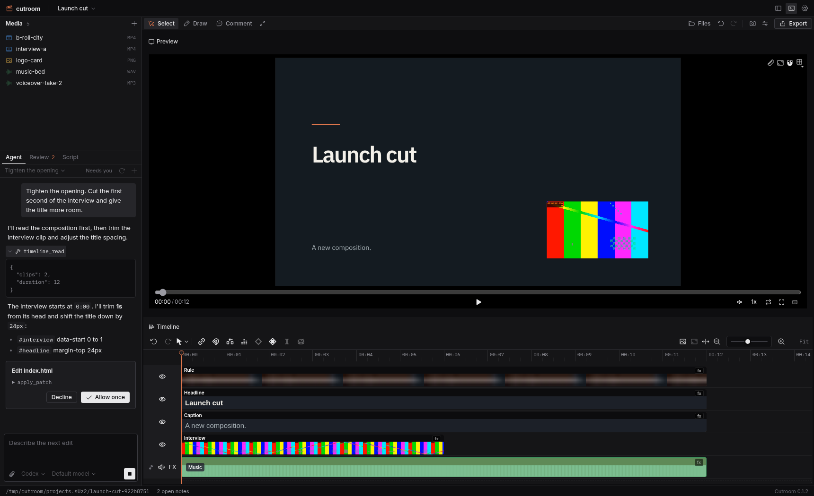

# Cutroom

A local video studio with native coding agents, visual review, and script editing.



- Edit compositions on the canvas and timeline, with source files and shared undo history.
- Draw on a frame, pin timed comments, and send a batch of notes to your agent.
- Transcribe local footage, select words, and cut or restore them without changing the original media.
- Run installed Codex or Claude Code with their own skills, models, configuration, and sessions.
- Let outside agents work on the same projects over MCP.
- Export video locally. No Cutroom account is required.

## Run

The [Linux release](https://github.com/AksharP5/cutroom/releases) includes Bun and Node.js. Extract it and run `./install.sh` to add Cutroom to your application launcher. Run `./cutroom` directly to use the portable folder.

### From source

Requires Bun 1.4.4 or newer, Node.js 22.18 or newer, FFmpeg, and a Chromium-compatible browser. Agent chat additionally requires an installed and authenticated Codex or Claude Code. Whisper transcription is optional.

```sh
bun install
bun run build
bun run desktop
```

For the browser interface:

```sh
bun start
```

Open `http://127.0.0.1:4317`. `bun run dev` starts the development interface on port 5173.

## Projects and agents

Create a project or open an existing HyperFrames folder containing `index.html`. New projects live in `~/Videos/Cutroom`; application data lives in `~/.local/share/cutroom`. Set `CUTROOM_PROJECTS_DIR`, `CUTROOM_DATA_DIR`, or `CUTROOM_PORT` to change those defaults.

Choose Codex or Claude Code in the agent panel. Type `$` to select one of that provider's installed skills. Claude selections are dispatched using its native skill command. The studio shows native approvals and questions in the chat. [Agent behavior](docs/agents.md).

If your agent is signed out, authenticate through its own CLI with `codex login` or `claude auth login`, then refresh the agent configuration in Cutroom.

**Media** at the top left lists the project's video, audio, and images. Import files with **+** or drop them on the panel; they are copied into `assets/`. Switch between **Agent**, **Review**, and **Script** below it. Drafts stay in place when you change tabs.

Use **D** to draw, **C** to comment, and **V** to select. In Script, select a word and Shift-click another to select a passage. Cuts ripple the selected media lane; other tracks keep their authored timing. Complex scripted or linked edits can be handed to the agent.

See [local transcription](docs/transcription.md) and [editing behavior](docs/editing.md) for supported inputs and undo details.

## MCP

Cutroom must be running. Add the local bridge to an external agent, replacing the path with your checkout:

```sh
codex mcp add cutroom -- bun /absolute/path/to/cutroom/src/server/mcp/stdio.ts
claude mcp add cutroom -- bun /absolute/path/to/cutroom/src/server/mcp/stdio.ts
```

The bridge and the editor use the same project commands and history. Set `CUTROOM_URL` for a nondefault local port. The HTTP endpoint at `/mcp` also accepts local MCP clients. [Available tools](docs/mcp.md).

## Development

```sh
bun run check
bun test
bun run test:e2e
bun run format:check
```

To build and install the Linux desktop app from source:

```sh
bun run package
bun run install:desktop
```

Browser tests need Chromium or a Playwright browser installation. `CUTROOM_BROWSER_PATH` selects an executable. `bun run package` builds the portable Linux distribution.

[Architecture](docs/architecture.md) describes the editor integration and dependency upgrades.

## License

Original Cutroom code is [MIT-licensed](LICENSE). HyperFrames, GSAP, agent runtimes, fonts, and other dependencies retain their own licenses. See [third-party notices](THIRD_PARTY_NOTICES.md).
