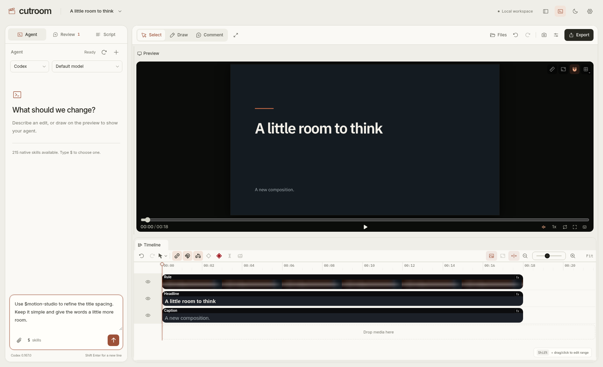

# Cutroom

A local video editor for HyperFrames projects. Edit the timeline yourself, or work with Codex and Claude Code through the same project files and undo history.



- Cut and mix footage, animate clip properties, and edit HyperFrames compositions.
- Draw on the viewer or pin a timed comment, then send your notes to an agent.
- Transcribe local footage, cut and restore words, and add captions.
- Export MP4, MOV, WebM or GIF locally.

## Install

Download the [Linux release](https://github.com/AksharP5/cutroom/releases), extract it, and run `./install.sh` to add Cutroom to your app launcher. Use `./cutroom` to run the portable copy directly. The package includes Bun and Node.js. Install FFmpeg and a Chromium-compatible browser for local exports.

### From source

Requires Bun 1.4.4 or newer, Node.js 22.18 or newer, FFmpeg, and a Chromium-compatible browser.

```sh
bun install --frozen-lockfile
bun run build
bun run desktop
```

For the browser interface, run `bun start` and open `http://127.0.0.1:4317`. For development, use `bun run dev`.

## Open a project

Create a project or open a HyperFrames folder containing `index.html`. New projects live in `~/Videos/Cutroom`, and application data lives in `~/.local/share/cutroom`. Set `CUTROOM_PROJECTS_DIR` or `CUTROOM_DATA_DIR` to change those paths.

Install and authenticate Codex or Claude Code to use the Agent panel. Type `$` in the composer to choose a native skill. Cutroom uses the provider's own configuration and shows its approvals in chat. [Agent setup and review workflow](docs/agents.md).

[Editing and export](docs/editing.md) · [Keyboard shortcuts](docs/keyboard.md) · [Local transcription](docs/transcription.md)

## MCP

With Cutroom running, connect an external agent to its local endpoint.

```sh
codex mcp add cutroom --url http://127.0.0.1:4317/mcp
claude mcp add --transport http cutroom http://127.0.0.1:4317/mcp
```

Use `CUTROOM_PORT` to change the listening port. For the stdio bridge, tool inputs and examples, see [the MCP guide](docs/mcp.md).

## Develop

```sh
bun run check
bun test
bun run test:e2e
bun run format:check
```

Set `CUTROOM_BROWSER_PATH` if the tests need a specific Chromium executable. Run `bun run package` to build the Linux archive. [Architecture and dependency upgrades](docs/architecture.md).

## License

Cutroom's original code is [MIT-licensed](LICENSE). Dependencies retain their own licenses. [Third-party notices](THIRD_PARTY_NOTICES.md).
