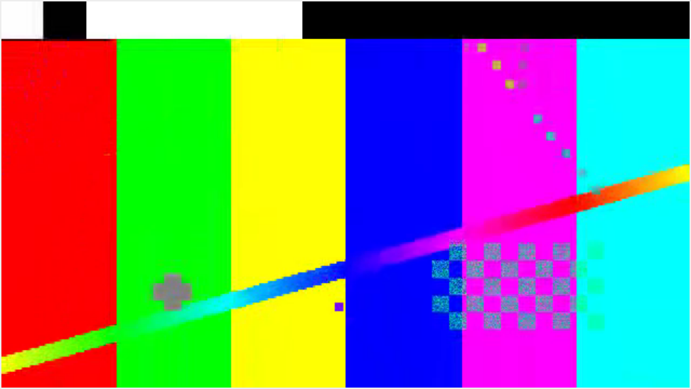
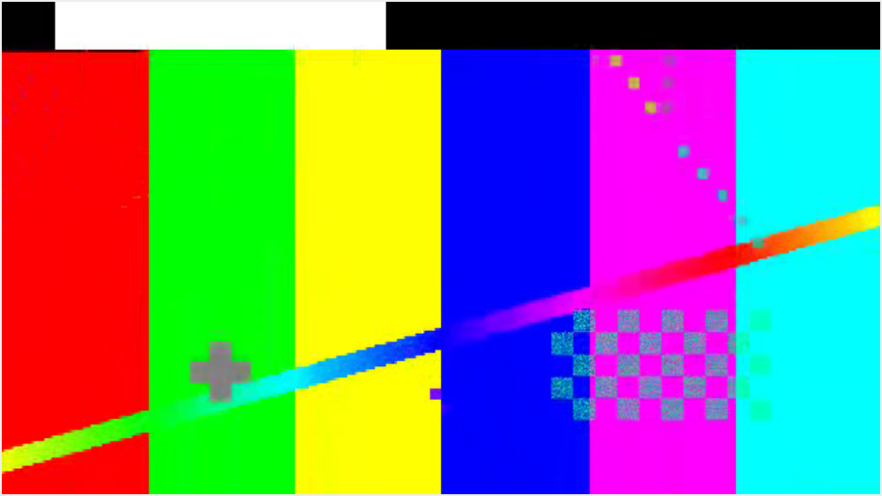

# Paused seek evidence

A paused preview must show the frame export writes before it reports ready.

These are original screenshots of the synthetic HEVC recording generated by
`e2e/frame-rounding.spec.ts`. Sixteen blocks across the top encode the source
frame number, white for 1, least significant bit first. Composition frame 6
starts at source time 2.1 seconds and should show source frame 126.

| Same seek                                                         | Burned-in source frame | Preview ready |
| ----------------------------------------------------------------- | ---------------------- | ------------- |
| Before, previous decoded picture supplied after the clock settles | 125                    | Yes           |
| After, while the previous decoded picture is supplied             | 125                    | No            |
| After, when the requested decoded picture arrives                 | 126                    | Yes           |

Before:

After:

The test holds a real decoded frame and supplies its clones at the browser's
`VideoFrame(video)` boundary after the native clock moves. It also seeks again
while that capture is stalled, checks that readiness stays cleared, and verifies
that the latest frame wins. A second stalled seek reaches the real hold timeout,
keeps the last picture unready, then recovers on another seek. All 30 paused
preview frames are compared with the actual MP4 export. This deterministic boundary test fails on `cc325a1f`.

The long HEVC test separately delays the real HLS request for piece 45 at 3:00,
checks that the old picture stays unready, then reads burned-in frame 5400 as
soon as readiness returns. It runs with the pipeline setting both off and on;
until the editing proxy finishes, the enabled pipeline falls back to HyperFrames.

The intermittent CI failures were not reproduced naturally in the bounded local
runs. These tests reproduce two concrete gaps: a seek could retain the old ready
flag, and a successful decoded snapshot was accepted without checking its decoded
identity. They do not prove that both CI failures followed the same sequence.

A sparse VFR recording and a one-second video with a two-second audio track
exercise valid held pictures. At 1.5 seconds they display source frames 30 and
29 respectively, even though each decoded frame reports a nominal duration of
about 33 ms. Both timed out with the interval check; both now become ready with
the correct burned-in picture, including repeated seeks within the held frame.

The same fixtures have three-second authored clips, longer than their source
media. Seeks to 2.2 and 2.4 seconds keep the final source frame and become
ready, then a backward seek recovers the earlier held picture. The native
endpoint is unchanged between those late seeks, so no new presentation is
required. Existing snapshot-loss and overlapping-preview-swap workflows also
cover initial source pictures arriving before the seek target.
