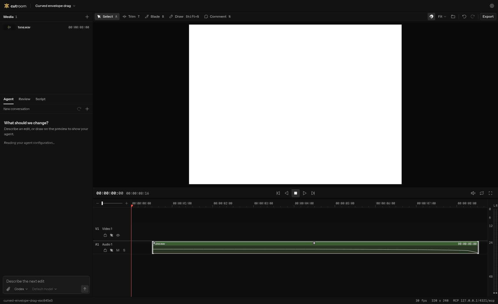
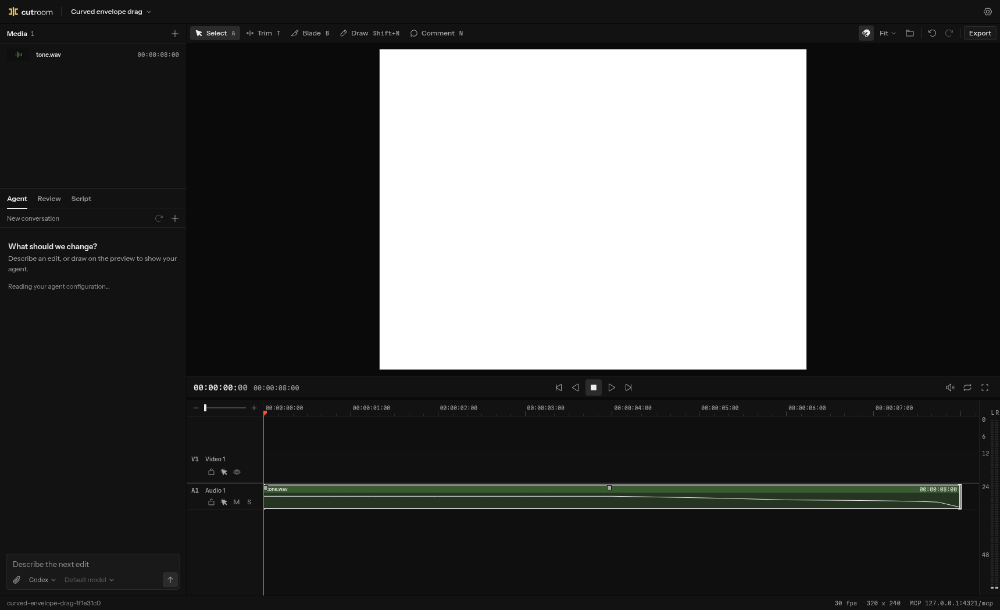

# R2 fixes

Before is PR #38 head `05b2b4b`. After is `2d97e40572b179f7401fe9ae3f5eb45c6438d63b`, rebased on main `fb2569b`.

## Edge fades

Generate a 220 Hz sine at 48 kHz. Start with an eight-second clip and a four-second native fade-out. Trim its end to six seconds, then extend it to eight seconds. Repeat as a roll against a following clip. Every step patches HTML and reads it back through the server composition parser.

Render the original and restored compositions through HyperFrames' real AAC audio producer, decode at 48 kHz, and compare peaks in 20 ms windows centered on each sample time. These are restored minus original levels in dB.

| Operation | Time | Before | After |
| --- | ---: | ---: | ---: |
| Trim out and back | 5.0 s | 0.00 | 0.00 |
| Trim out and back | 6.5 s | +2.44 | 0.00 |
| Trim out and back | 7.8 s | +19.73 | 0.00 |
| Roll out and back | 5.0 s | 0.00 | 0.00 |
| Roll out and back | 6.5 s | +2.44 | 0.00 |
| Roll out and back | 7.8 s | +19.73 | 0.00 |

Before readback loses the fade and stores automation ending at six seconds at 0.5. After readback retains `fadeOut: 120` and `automation: null` at both six and eight seconds. The shortened clip's levels are also tested against a separately authored six-second clip with a four-second fade-out, within 1 dB.

The original split regression is retained. Splitting the eight-second tone at four seconds measures 0.00 dB against the unsplit tone at 2, 3.95, 4.05, 5, 6.5 and 7.8 seconds. Cuts inside either fade and curved authored automation remain covered within 1 dB. A truncated cut ramp keeps its source endpoint beyond the split piece, so extending it reaches the original endpoint.

Raw readbacks and measurements: [before](measure-before.json), [after](measure-after.json).

## Curved gain drag

A real browser press starts on the displayed SVG envelope at 7.75 seconds, then travels 80 px right and 12 px up. Both captures use the same eight-second tone, four-second fade-out, dark theme, and 1720x1050 viewport. The point is located from the rendered path and its screen transform, without querying the gain hit target.

The browser regression checks that only gain changes, to +6 dB. One undo restores the exact original timeline and HTML bytes. A subsequent split and undo also restores the original bytes. A separate browser regression trims and rolls out and back, checks the native fade values, and undoes each gesture.

| After release | Before R2 | After R2 |
| --- | --- | --- |
| Clip start | 16 frames | 0 frames |
| Clip gain | 0 dB, unchanged | +6 dB |

Raw browser readbacks: [before](curve-before-r2.json), [after](curve-after-r2.json), [trim and roll](edge-readback.json).
