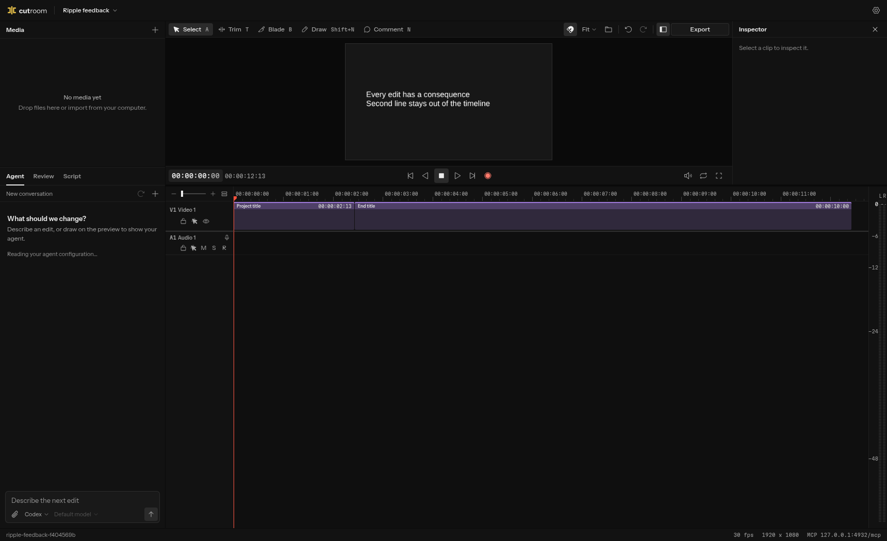
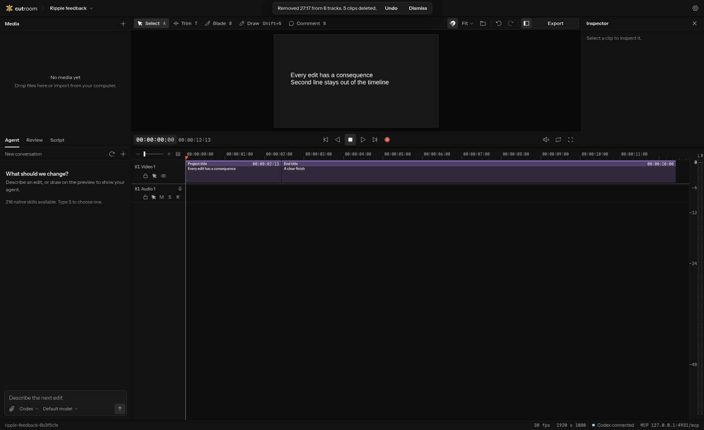
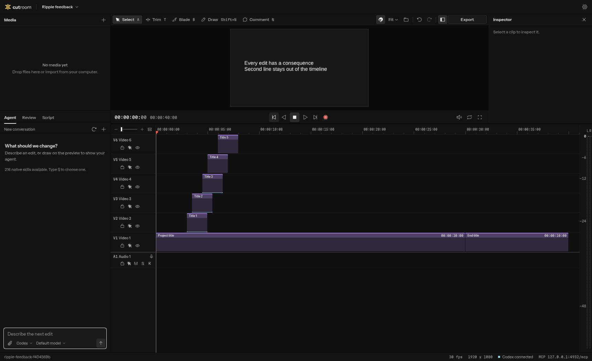
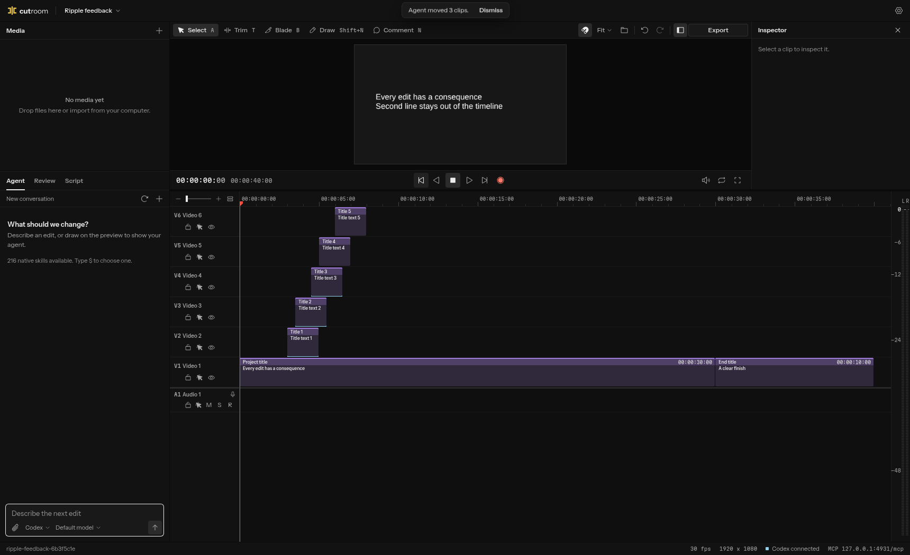
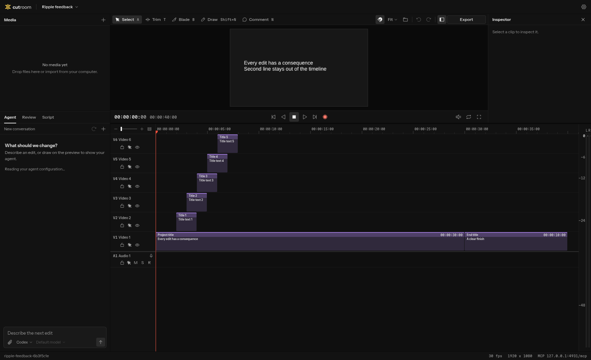
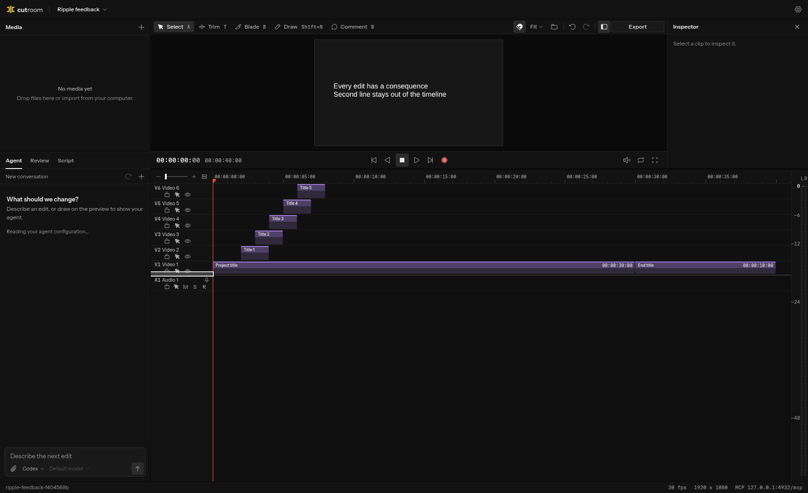
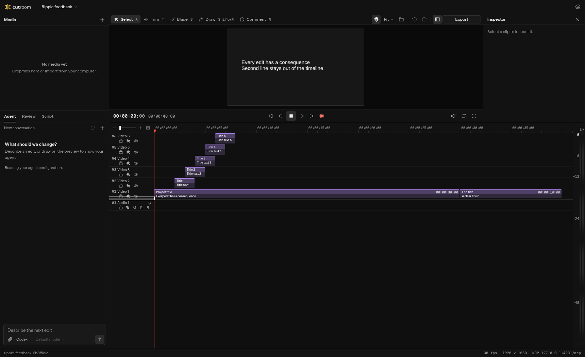

# Ripple feedback

Design checkpoint 5, item 10. Matching captures from the production builds of `origin/main` at `65dbdf0` and `ripple-feedback`, using installed Chromium 155 at 1720×1050 and DPR 1, with audio muted. Both use the same synthetic composition and a timeline resized to start at y=360. Source media and private projects are absent.

| Scenario | Before | After |
| --- | --- | --- |
| Q at 00:00:27:17 |  |  |
| Four outside agent moves affecting three distinct clips |  |  |
| Title text at normal height |  |  |
| Compact density with V1 at its 28 px minimum |  |  |

Implementation source: [`a57bd30`](https://github.com/AksharP5/cutroom/commit/a57bd30d4e95711a5c7a12ac6c7d0feab0d7092b).

The Q case trims the 30-second Project title, removes the five short titles on other tracks, and shifts End title left. One toast reports that result. Clicking its Undo restores all seven clips in one step. Simple same-track Q stays silent. Ripple delete, insert drops and Paste Insert use the same reporting path.

Agent moves use the commands endpoint with `x-cutroom-agent: external`, the same endpoint used by MCP. The notice counts distinct changed clips rather than requests. Focus remains in the chat field. The browser check also verifies that the notice expires. Disk-written text changes refresh the title preview and produce an outside-edit notice.

The first title's second authored line is visible in the viewer and absent from the timeline preview. The two-second titles ellipsize within their clip bounds. The text uses the existing 10 px clip-label scale and colour. It is extracted from the existing parse tree, with no parsing during playback.

## Validation

Bun 1.4.4, installed Chromium 155.0.8059.84 with SwiftShader, 1720×1050, DPR 1, muted, on a shared host. The production performance suite ran once, with its default three runs per 400/500-clip workload. All five checks passed.

| Clips | Key zoom p95 | Worst key frame | Ripple p95 | Worst ripple frame |
| --- | ---: | ---: | ---: | ---: |
| 400 | 26.3 ms | 75.5 ms | 43.8 ms | 84.5 ms |
| 500 | 25.8 ms | 106.1 ms | 51.5 ms | 79.2 ms |

These timings remain inside the existing 150 ms gates. They establish budget compliance on this host, rather than a timing comparison with an earlier build. The roll's median p95 was 25.8 ms, with at most one seek pending. Track resizing produced zero per-clip writes and zero canvas reallocations. The selected Position observation peaked at 0.8 ms. [Raw measurements and workload screenshots](performance/).

Formatting and TypeScript checks passed. Unit tests passed with 565 tests and five skips. All 238 functional browser cases passed, including the six-track Q and Undo, silent single-track Q, later-history invalidation, coalesced agent moves without focus changes, and title text updates from disk. The local Playwright config was uncommitted and used port 4930 with a separate data directory.
