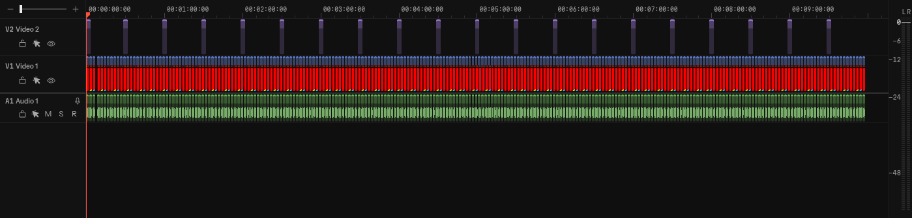
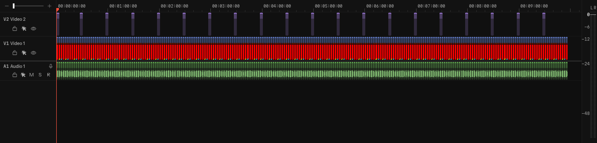

# First ripple delete after loading

Baseline: `6e6094c02a7d81fa888ea3751ef4a1ec29d9bf97`. The source branch is `ripple-first-edit`, head `bd9777f79e4adaf9d5734f3ffe2d44b5f104e02f`. The head rebases the validated implementation onto CI/documentation-only main `f7271b8fdcf71bf3a85c2e1a75a38e487f2a2fc5`; application and test files are unchanged by that rebase. Browser, renderer and viewport are in `environment.json` and every timing file.

Three independent backend/browser sessions per build, with three interaction runs per count and session. Production builds on the same host, Bun 1.4.4 and installed Chromium 155.0.8059.84 with SwiftShader, 1720x1050, no CPU throttle. `before-1` and all three after sessions ran `bun run test:perf`. Before sessions 2 and 3 ran the timeline spec against unchanged production assets from session 1, with fresh backends and browser contexts. Functional tests were not running during these measurements.

Each cell lists sessions 1 / 2 / 3 in milliseconds. Median max is the median of the three interaction-run maximum frame gaps within that session. P95 pools the three runs' frame samples within that session.

| Clips | Gesture | Before median max | After median max | Before p95 | After p95 |
| ---: | --- | ---: | ---: | ---: | ---: |
| 400 | key | 60.7 / 62.1 / 64.7 | 66.4 / 64.4 / 63.9 | 29.3 / 23.0 / 22.3 | 22.9 / 20.7 / 20.5 |
| 400 | wheel | 45.2 / 48.4 / 46.2 | 54.0 / 48.3 / 47.4 | 25.4 / 27.4 / 27.1 | 26.1 / 25.3 / 24.5 |
| 400 | ripple | 68.3 / 67.2 / 65.5 | 60.1 / 49.1 / 59.1 | 41.2 / 43.3 / 37.5 | 37.5 / 30.9 / 37.7 |
| 400 | undo | 55.4 / 53.3 / 61.9 | 43.3 / 50.3 / 50.1 | 44.6 / 40.3 / 37.4 | 31.9 / 38.2 / 35.9 |
| 400 | redo | 58.3 / 54.5 / 58.1 | 52.8 / 56.8 / 56.6 | 46.1 / 42.4 / 40.2 | 42.9 / 40.8 / 44.0 |
| 400 | fit | 24.4 / 28.4 / 26.5 | 26.7 / 20.9 / 22.2 | 16.8 / 16.9 / 16.9 | 16.9 / 16.8 / 17.1 |
| 500 | key | 50.0 / 60.2 / 57.4 | 61.9 / 61.6 / 61.8 | 27.2 / 19.1 / 19.6 | 19.7 / 19.7 / 19.4 |
| 500 | wheel | 58.1 / 49.5 / 59.8 | 55.4 / 54.9 / 55.1 | 26.1 / 28.0 / 26.5 | 25.8 / 26.0 / 25.5 |
| 500 | ripple | 87.2 / 82.3 / 88.4 | 62.4 / 50.7 / 77.4 | 56.6 / 58.4 / 55.9 | 42.2 / 33.9 / 45.4 |
| 500 | undo | 65.4 / 67.7 / 75.6 | 52.2 / 54.9 / 66.2 | 35.9 / 54.0 / 46.7 | 38.1 / 41.8 / 39.3 |
| 500 | redo | 75.6 / 72.1 / 71.2 | 53.4 / 62.5 / 55.1 | 52.2 / 57.1 / 56.6 | 32.6 / 35.2 / 39.5 |
| 500 | fit | 26.5 / 32.1 / 32.9 | 24.0 / 29.7 / 31.3 | 17.0 / 18.1 / 16.8 | 16.9 / 16.8 / 16.8 |

`before-*` and `after-*` contain every frame gap and long task. `comparison.json` contains their summaries. `first-ripple.json` retains the first edit's maximum separately, since a per-session median can hide a first-only stall. All six after count/session budget checks passed without changing the 150 ms ceiling.

## Chromium traces

The separate `before-trace/` and `after-trace/` sessions used `CUTROOM_PERF_TRACE=1 CUTROOM_PERF_RUNS=1`. Their times include profiling overhead. `trace-summary.json` retains the main-thread style/layout events in each worst ripple frame and the first ripple frame. Run `python analyze-traces.py` from this folder to regenerate it.

The first 400/500-clip frame fell from 82.2/97.3 to 50.0/60.3 ms. The largest style pass in that first frame still counts 782/982 elements because the near-start edit moves almost every clip, but drops from 30.991/35.282 to 9.178/13.247 ms. Total layout in that frame drops from 14.595/17.265 to 10.916/13.997 ms.

The worst remaining ripple frames occur later, 317/402 ms after input. Their gaps are 61.0/65.8 ms; their largest style events cover 2/41 elements in 0.126/0.265 ms, with total layout 0.803/0 ms. These later frames should not be mistaken for the first-frame setup comparison.

## Matching images

The `before-visual/` and `after-visual/` images use the same 500-clip workload at Fit. `capture-visual.spec.ts` freezes DOM and canvas animation clocks at 110 ms for the mid-slide frame, with Fit paused, then finishes the slide and Fit for the after-edit frame. `capture.json` records matching clip bounds and scale at both points. The representative clip bounds are exactly equal in both builds. I inspected both image pairs. They have small rasterization differences; they are not pixel-identical. Mean RGB channel differences are 0.109/255 mid-slide and 0.021/255 after Fit. `visual-comparison.json` retains the pixel comparison.

| Frame | Before | After |
| --- | --- | --- |
| 110 ms into the slide |  |  |
| Edit and Fit settled |  |  |

## Reproduction

Use the repository's installed dependencies and browser. For an isolated local run, copy `pw-local.config.ts` to the checkout and select a throwaway directory with `CUTROOM_E2E_DIR`. It uses port 4920.

```sh
CUTROOM_E2E_DIR=/tmp/ripple-e2e CUTROOM_PERF_DIR=/tmp/ripple-perf bun run test:perf --config pw-local.config.ts
CUTROOM_E2E_DIR=/tmp/ripple-trace-e2e CUTROOM_PERF_DIR=/tmp/ripple-trace CUTROOM_PERF_TRACE=1 CUTROOM_PERF_RUNS=1 bun run test:perf --config pw-local.config.ts e2e/timeline-performance.spec.ts
```

For the controlled image capture, copy `capture-visual.spec.ts` to `e2e/rfe-visual.local.spec.ts`, build, and run it with `RFE_VISUAL_DIR` set. The capture hooks run only in that test's browser context; performance measurements use the unmodified browser clocks. No evidence or local test configuration belongs on the source branch.

## Validation

Validated locally:

- `bun run format`, `bun run format:check`, `bun run check`.
- `TMPDIR=/home/akshar/.cache/rft bun test`: 460 passed, 5 skipped, 0 failed.
- Full functional e2e via an uncommitted `pw-local.config.ts`, port 4920 and a throwaway data directory: 182 passed. Includes compact/long timeline coordinates, overlapping undo, held trims, Fit interruption, and voiceover recording against the playhead.
- `bun run test:perf --config pw-local.config.ts`: three successful independent sessions, plus separate before/after trace passes.
- Controlled 110 ms and settled image pairs inspected above.

Rebased onto the latest main's CI/documentation-only change after validation; application, test, script, and package files are byte-identical to the validated head. Type and formatting checks passed after the rebase. No software or browsers were installed.
